# Unit-test generator: agent orchestration

Requirement IDs in brackets refer to `unittest_generator_requirments.txt`.

| Agent | Python file | Role |
| --- | --- | --- |
| Orchestrator | `ut_pipeline.py` | Runs the pipeline, the only MCP client of the agents [ORC-1] |
| Agent1 | `agent_unittest_analyzer.py` | Discovery, evidence, setup-repair plan, coverage plan |
| Agent2 | `agent_unittest_generator.py` | Test suites, test cases, stubs, test-side fixes |
| Agent3 | `agent_unittest_compilation.py` | Harness, build, run, coverage, classification, routing |
| Agent4 | `agent_sourcecode_corrector.py` | Production-source corrections |
| KB | `ut_fix_knowledgebase.py` | Advisory examples from verified results |
| Contracts | `ut_contracts.py` | Every handoff schema, the tool manifest reader |
| Setup | `ut_setup.py` via `unittest_generator.bat` / `.sh` | Checks and installs the tools into `tools\` [TP] |

Three layers everywhere: the brains (the Claude models the API key can access, else Qwen3 8B) only suggest; the agents check every suggestion
deterministically and decide; the tools (compiler, coverage, git) act. Where the brain is used:

| Agent | The brain suggests | Checked by |
| --- | --- | --- |
| Agent1 | stub or real per dependency [A1-DA8] | rules, then Agent3's build [A1-DA9, A1-DA12] |
| Agent1 | test scenarios per function, from the second plan on [A1-PL1] | A1-PL4: gap ids, quotes word for word, value ranges, stubs, no E8 or conflicting expectation |
| Agent1 | which functions a requirement in prose describes [A1-PL13] | id and quote exist; such evidence never justifies a source fix [A4-23i] |
| Agent1 | a declaration for a symbol that has none [A1-PL14] | parses as that symbol; Agent3's build |
| Agent2 | test code the scenarios cannot be assembled into; rewrites of failing E1-E7 tests [A2-21m..A2-21p] | symbols that exist, readable names; Agent3 runs them; oracle check for changed expectations |
| Agent3 | root cause of a failing test with stated evidence [A3-CL] | p >= 0.8 for a source defect; linked evidence -> requirement_mismatch [A3-CL11] |
| Agent3 | missing flags of an estimated build [A3-BD11] | allowed flags, cited text exists, kept only if the SUT's errors drop [A3-BD12] |
| Agent4 | up to 3 candidate fixes [A4-23g] | fragment checks, Agent3 reverifies each, publication rules; smallest one wins |
| Agent4 | a second opinion from another brain [A4-23h] | can only block |
| Agent4 | after a stop below target: source changes that let tests reach the open items, from the requirements [COV-12] | fragment and quotes word for word; Agent3 measures each on a trial copy; shown only when it reaches more and lowers nothing, and the tests still detect every compared mutant they detected before (Agent3 fault_check, no brain); never applied [COV-13, COV-14 .. COV-19] |

## 0. Tools first

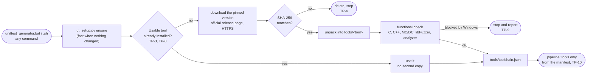

The application never searches for tools and has no fallback compiler. Windows uses llvm-mingw (self-contained, no administrator rights) unless a working Visual Studio/LLVM installation exists; Linux uses an installed Clang 18+ or the official LLVM release. Per repository, Make, Meson and Bazel are added when its build files need them [TP-5].

## 1. The whole pipeline

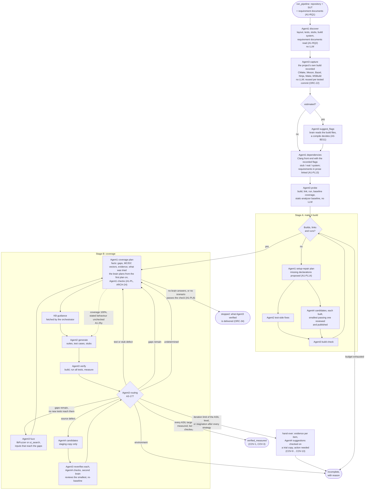

Agent1 is the only agent that sends work to Agent2 [A1-35]. Agent3 decides the routing; the orchestrator executes it [ORC-6].

## 2. Routing by failure category

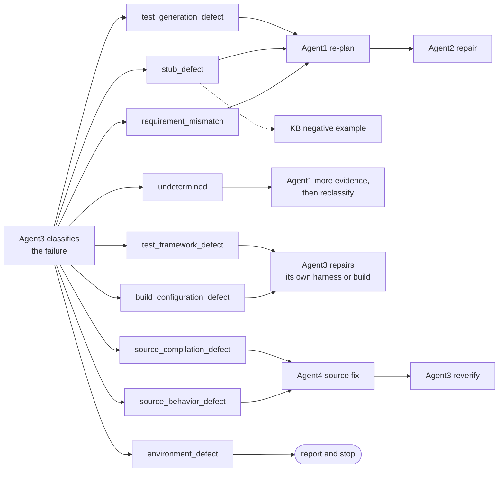

## 3. One coverage iteration, call by call

Every arrow is an MCP tool call made by the orchestrator. Every payload is a contract from `ut_contracts.py`, checked by the receiver (preconditions) and by the orchestrator (postconditions), and written to the ledger [ARCH-4, ORC-8].

```mermaid
sequenceDiagram
    autonumber
    participant O as Orchestrator
    participant A1 as Agent1
    participant KB as KB
    participant A2 as Agent2
    participant A3 as Agent3
    participant A4 as Agent4
    participant L as Ledger

    O->>A1: plan(PlanRequest: layout, last VerificationResult, attempts, fuzz inputs, per-test items)
    Note over A1: facts first; from the 2nd plan the brain suggests<br/>scenarios per function, Agent1 checks each (A1-PL4)
    A1-->>O: UTPlan (scenarios with who made them, repair items, conflicts, look-ups)
    O->>KB: guidance(GuidanceRequest)
    KB-->>O: KBGuidance (advisory examples)
    O->>A2: generate(GenerationRequest: UTPlan + KBGuidance + current suite)
    Note over A2: checked scenarios assembled directly; the LLM writes<br/>requirement tests, hard set-ups and rewrites (A2-21m..p)
    A2-->>O: FileActionBundle (stubs, suite, tests, probes for E8 values)
    opt the bundle observes values (A2-21f)
        O->>A3: observe(VerifyRequest: bundle)
        A3-->>O: observed values + per-test coverage (A3-OBS5)
        O->>A2: finalize(FinalizeRequest)
        A2-->>O: FileActionBundle (assertions, redundant probes removed, A2-21i)
    end
    opt Agent2 declared expectation changes
        O->>A3: oracle_check(OracleRequest)
        A3-->>O: OracleResult (weakening -> original test kept)
    end
    O->>A3: verify(VerifyRequest: layout + bundle + previous result)
    A3-->>O: VerificationResult (build, tests, coverage, classification, routing)
    O->>L: append every call (hashes, signatures, status)
    O->>KB: learn(LearningEvent), only from Agent3's evidence
    alt complete and verified
        O->>A1: plan - done, or behaviour scenarios still to check (A1-25y)
    else gaps without failures, not fuzzed yet
        O->>A3: fuzz(FuzzRequest: functions, gaps, covered items)
        A3-->>O: FuzzResult (concrete inputs, the gaps they reach)
        O->>A1: plan(PlanRequest with the inputs, A1-18c)
    else gaps, test or stub defects, undetermined
        O->>A1: plan(PlanRequest with the new VerificationResult)
    else source defect (route agent4)
        O->>A1: collect_evidence(function)
        O->>A4: candidates(CorrectionRequest: failure, two independent evidence items, test)
        A4-->>O: CandidateSet (up to 3, never applied to your files)
        loop every candidate
            O->>A3: verify(VerifyRequest with the patched source + static analyzer)
            A3-->>O: VerificationResult (reverified, analyzer findings)
            O->>A4: check(PublishRequest)
            A4-->>O: PublishCheck
        end
        O->>A4: review(ReviewRequest: smallest passing candidate)
        A4-->>O: ReviewResult (another brain; can only block)
        O->>A4: publish(PublishRequest: patch + Agent3's result + analyzer baseline)
        A4-->>O: PublishResult (patch file; branch, or the review pull request for a link)
        O->>A1: discover + dependencies (re-baseline on the fixed source, A4-40)
    end
```

## 4. Inside every agent: BaseAgent-derived agentic RAG

```mermaid
flowchart LR
    req["MCP tool call<br/>BaseAgent envelope<br/>+ contract payload"] --> pre["check preconditions<br/>and signatures"]
    pre --> retrieve["retrieve evidence<br/>from the agent's<br/>knowledge store"]
    retrieve --> det["deterministic tools<br/>parse, build, measure"]
    det --> need{"LLM needed?"}
    need -- no --> act
    need -- yes --> packs["knowledge packs<br/>for this step (KP-3)"]
    packs --> budget["token budget per call<br/>window and answer limit (ARCH-11)"]
    budget --> brain["brain router<br/>accessible Claude model,<br/>else Qwen3 8B"]
    brain --> check["validate against<br/>the contract schema"]
    check -- invalid --> brain
    check -- valid --> act["act and build<br/>the response contract"]
    act --> resp["AgentResponse<br/>status, data, meta, error"]
```

An invalid LLM answer is asked again once and otherwise rejected [ARCH-5].

### 4a. Rule first, brain when the rule fails, the tool decides [ARCH-21 .. ARCH-23]

Every agent runs its deterministic rules first: they are fast and repeatable. A rule that meets code it was
not written for does not end with "cannot". It hands the case to the brain through BaseAgent's
`AgentCore.resolve()`, and the tool that rejected the rule's result judges the brain's answer:

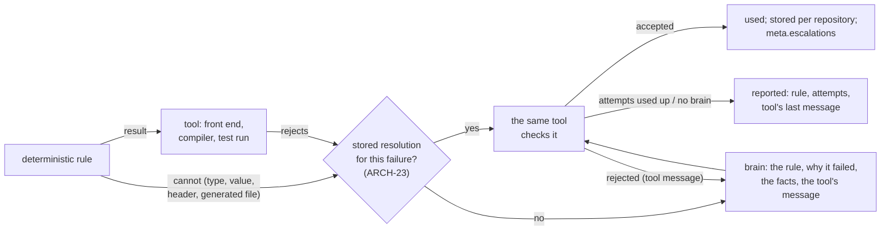

| Agent | Rule that can fail | What the brain gets | The tool that decides |
|---|---|---|---|
| Agent1 | a header the front end does not find (A1-DA20); after a search by name with one candidate | candidates with that name, the folders with headers | the front end parses again: the header is found and errors do not grow |
| Agent2 | a parameter whose value no rule can build (A2-21ac) | the function, the type's declarations, the SUT's functions | declared symbols only, no assertion; then Agent3's build; stored only once tests using it are in the verified suite |
| Agent3 | the test program does not build in generated files (A3-CL14) | compiler errors, the generated files, the SUT's include lines | the compiler: fewer errors; assertions, test names and calls unchanged |
| Agent3 | the SUT does not compile on the host after the keyword and assembly tables (A3-BD16) | compiler errors, the SUT, the flags | the compiler: fewer SUT errors; no SUT function defined, no user file changed |
| Agent4, Agent1 planning | already brain steps (A4-23g, COV-12, A1-PL1) | as before | Agent3's verify |

The result and the report list every case under "Rules that needed the brain".

## 5. Which brain answers, and how the agents are reached

Every brain call goes to the first available brain in `brain.engine.brain_order` of `ut_config.json` [ARCH-1a].
When the agents start, BaseAgent checks which Claude models the API key in `ANTHROPIC_API_KEY` can access (no
tokens are spent). Models without access are skipped for the whole run, and Qwen3 8B through Ollama answers only
when no Claude model is available. The same code, tasks, checks and token budgets are used for every brain
[ARCH-1b]; `unittest_generator.bat check` shows which brains are in use.

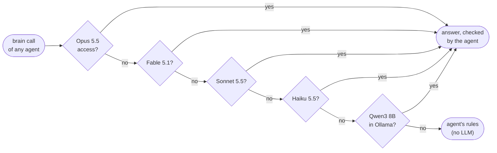

The order, the model ids and which brains are enabled are configuration only. A brain that is only unreachable
for a moment is skipped for the cooldown and tried again; a brain that is not enabled is never sent anything
[ARCH-9].

The agents themselves are reached in one of two ways, again only by configuration (`pipeline.agents`): started
by the orchestrator as subprocesses (MCP over stdio, the default), or as FastMCP HTTP servers with a bearer token
each, for example on a build server next to the code and the compiler [ARCH-7, ARCH-8].

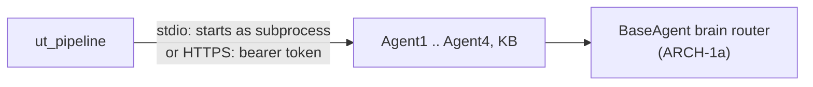

## 6. A repository link: cache, worktrees, delivery

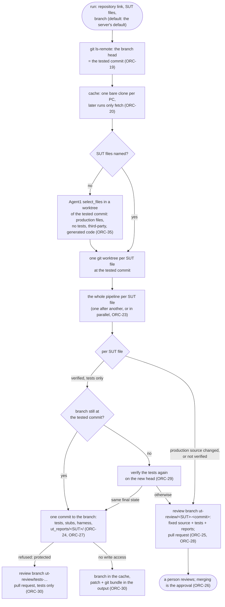

Git uses the login already configured on the PC (Git Credential Manager, SSH key) or a token in the environment
variable named in `ut_config.json`; it is never written anywhere [ORC-21]. The pipeline never force-pushes,
rewrites history, or deletes or renames a branch [ORC-31].

## 6a. Requirement documents given for a run [A1-RQ1 .. A1-RQ6]

`--requirements FILE_OR_FOLDER` (repeatable; in the menu of `unittest_generator.bat` one question), the request of
`run_pipeline` / `run_repository` (paths inside the repository only) or `"requirements"` per repository in
`ut_config.json`. The orchestrator copies every ReqIF, Markdown, text or CSV document unchanged into
`<run>/requirements/` and records its SHA-256 in the ledger; Word, PDF and Excel files are reported, not read.
Agent1 reads them as E1 evidence (an ID stated differently in the repository is a conflict; the given text is
used), links them by rule or by the brain (A1-PL13), and at the end reports per function which requirements a
passed test asserts and which functions have no stated behaviour at all (tool `requirement_status`, A1-RQ5).
The documents never reach the repository.

## 7. Knowledge packs and the token budget of every brain call

**Knowledge packs.** Short Markdown files with rules and worked examples, added to a brain's prompt after the facts,
so that every run, both brains and every project choose the same way [KP-1 .. KP-9]. They are advisory: no check is
relaxed, and expected values still come only from evidence [KP-5, KP-6]. Not the KB (learned examples), and not
`.github/skills` (guidance for whoever changes this application).

| Pack | Read by | Status |
| --- | --- | --- |
| `knowledge/test-design.md` | Agent1 planning (A1.plan), Agent2 tests (A2.tests) | version 1.0, used |
| `knowledge/test-style.md` | Agent2 tests (A2.tests); a project's `.ut/knowledge/test-style.md` replaces it | version 1.0, used |
| embedded C patterns | Agent1 dependencies and planning, Agent2 tests | planned |
| fix and review checklist | Agent4 candidates and review | planned |
| reading build files | Agent3 flag suggestions | planned |
| reading requirements | Agent1 requirement links | planned |

Every agent loads the packs when it starts (`knowledge` in `ut_config.json`; BaseAgent's `KnowledgePacks`) and
each brain call names its step, so it gets exactly the packs whose `used_by` names that step. A project adds or
replaces packs in `.ut/knowledge/` of its repository. A pack without a valid header or with an unknown step is
not used and is reported in the agent's log. `UT_KNOWLEDGE=off` switches all packs off;
`unittest_generator.bat benchmark both` runs the benchmark with and without them and compares the results [KP-8].

**Token budget.** No call has a fixed size [ARCH-11 .. ARCH-17]. The agent passes its context as parts with a
priority and says how long the answer will be (for example 320 tokens per scenario for the open gaps). BaseAgent
then plans the call for each brain:

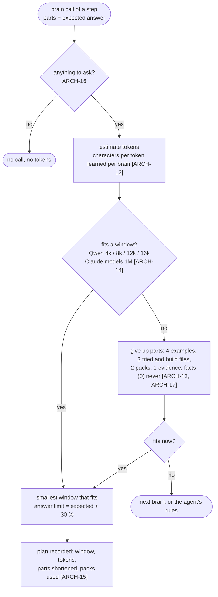

| Priority | Parts |
| --- | --- |
| 0, never cut | function source and signature, gaps or failure, parameters, scenarios, stub header, re-ask problems |
| 1 | expected-behaviour evidence; headers of the SUT (their beginning is kept) |
| 2 | knowledge packs |
| 3 | what was tried before, existing test names, build files, related source |
| 4 | KB examples, the existing test style |

Qwen keeps a loaded window while it is large enough (`sticky_window`), because Ollama reloads the model on every
change of the window. The result and `report.md` list per step how many calls were made, with which windows and
tokens, and what was shortened; the ledger has every single plan [ORC-12].

## 7a. Coverage targets and the stop [COV]

Every SUT file is ASIL D unless `coverage.files` in `ut_config.json` names another level for it [COV-2]. The targets
cannot be lowered and nothing is excluded: only measured coverage counts [COV-1, COV-3, COV-5].

| ASIL | Line, statement, branch, decision | MC/DC | Iterations (default) |
| --- | --- | --- | --- |
| D, C | 100 % | 100 % | 5 |
| B, A, QM | 100 % | above 95 % | 5 |

```mermaid
flowchart LR
    item["open item"] --> s1["brain scenarios<br/>(A1-PL1)"] --> s2["other values,<br/>stub return sequences"] --> s3["coverage-guided<br/>search"] --> s4["the next brain<br/>in the brain order"] --> s5["deterministic analysis:<br/>a proof is a diagnosis,<br/>never an exclusion"]
    s5 --> stop{"iteration limit<br/>or stagnation"}
    stop --> ev["evidence per item<br/>(COV-10)"] --> sug["Agent4 suggestions,<br/>hybrid reasoning over the<br/>facts and requirements"] --> trial["Agent3: trial copy<br/>builds, passes, reaches more"] --> faults["Agent3 fault_check:<br/>mutants on unchanged lines<br/>still detected (COV-14 .. COV-19)"] --> act["action needed<br/>report, PR, viewer (COV-11)"]
```

The run does not wait: a later run with requirement documents, or on a new commit after the developer changed the
source, continues from the stored build capture and the verified tests.

## 7b. The live viewer [VIEW]

Every run writes `events.jsonl` into its output folder and serves a page on 127.0.0.1 (a free port, printed at the
start; the browser opens by itself on a desktop). The brain is in the centre with the model that answered last; the
agents UT-Analyzer, UT-Generator, UT-Compilation, UT-Source Code Corrector and UT-KB are around it with their tools, and
UT-Orchestrator below them with the input of the run (SUT, repository, ASIL level) and its output (final state,
delivery). Every agent box shows, at all times, the input of its latest call (and who handed it over) and the output it
returned; clicking an agent lists every call of the run with tool, input, output and outcome [VIEW-8]. An agent that
was not called is greyed and says why, for example UT-Source Code Corrector when no source defect was found and every target was
reached [VIEW-9]. Every handoff and brain call is animated; the cards show line, statement, branch, decision and MC/DC coverage against the
file's ASIL targets and the tests passed; the end panel shows the final state and the action needed. At the end
`viewer.html` is written next to the events: it replays the whole run offline on any computer.

| Command | What it does |
| --- | --- |
| `unittest_generator.bat pilot-deps` | three C files, one page for all of them |
| `... run REPO SUT --no-view` | the run without the viewer |
| `unittest_generator.bat view ut_output\<run id>` | the page of an earlier run again, and its `viewer.html` |

Settings: the `viewer` section of `ut_config.json` (enabled, open_browser, host, port, replay, token_env, metrics). A
host other than 127.0.0.1 requires a bearer token from the environment variable named in `token_env` [VIEW-3]. The
events never contain source code, keys or tokens [VIEW-6].

## 8. What a run leaves behind

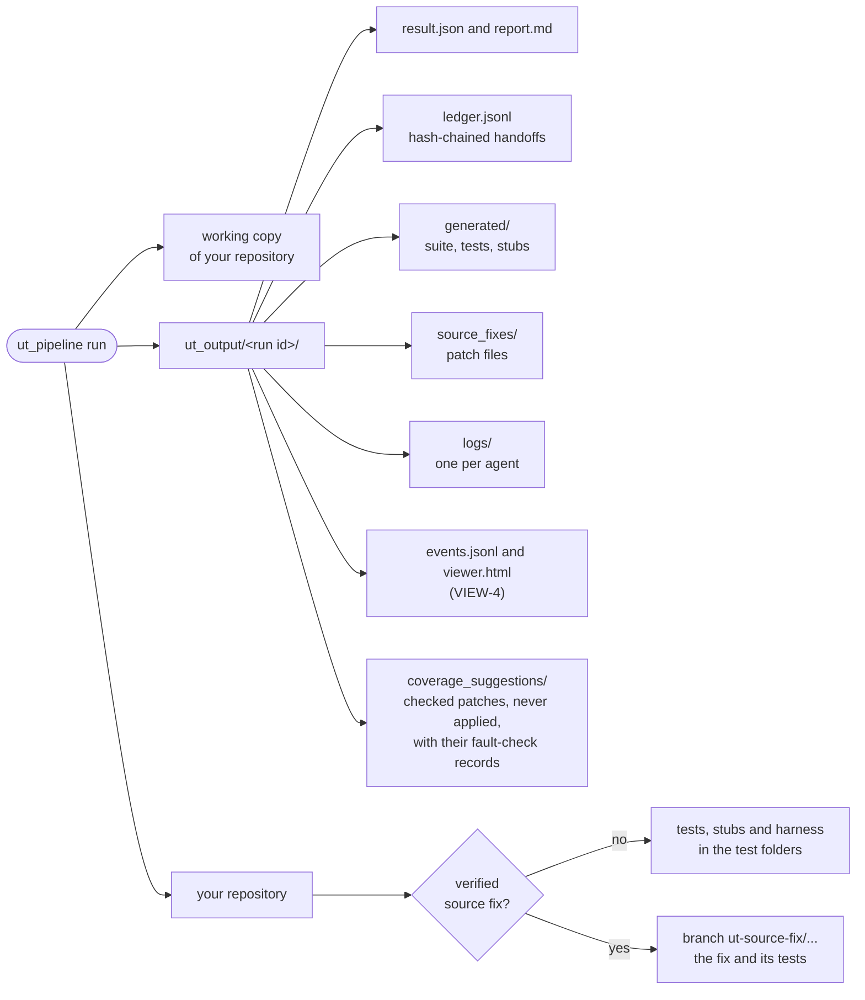

For a local folder (pilots, development): your working branch and production files are never changed. When a source fix was verified, the tests expect the corrected code, so they are committed to the fix branch next to the fix instead of the working tree [ORC-13a]. Every delivered file starts with `/* ut-generated-sha256: ... */`; a later run replaces it only while that hash still matches, so neither your own files nor files you edited are overwritten [ORC-13, ORC-14, ORC-14a, ORC-15, A4-23c].
