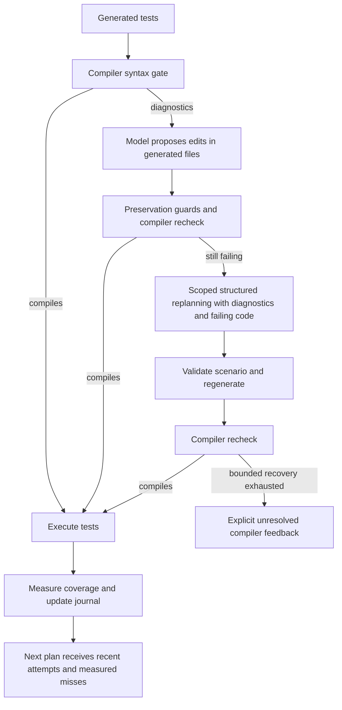

# Recovery fixes: validation record

## Evidence, control-flow proofs and search recovery (2026-11-01)

Based on main `132bf76` (the merged compiler-feedback recovery). The changes implement REC-14 through REC-18.
They use compiler facts, explicit evidence provenance, measured counterexamples and bounded model planning;
there are no pilot-specific source rewrites or operator substitutions.

- Missing evidence metadata remains unknown. Explicit E8 characterization remains distinguishable from missing
  provenance. Evidence references survive generation and retained-test merging; removed tests lose their metadata.
- A source-defect model hypothesis, including a cached one, must pass all six independent A3-170 checks before
  promotion. Each check records passed, failed or unknown and its basis. The generic implementation cannot
  independently establish arbitrary semantic input preconditions or framework correctness and leaves those checks
  unknown. Therefore high model confidence alone does not trigger automatic source correction. The positive
  correction/review delivery fixtures explicitly inject independent fixture receipts; they do not demonstrate a
  general semantic validator. Negative regressions test the real conservative defaults and every missing gate.
- An undetermined failure keeps its input and assertion. It cannot be rewritten as an observation just because
  Agent4 supplied no correction. A later unresolved failure also prevents an earlier passing suite from hiding it.
  The last passing suite remains deliverable; the unresolved suite and fixtures are retained separately in
  `unresolved_generated/`, with validation checks in `result.json` and `report.md`.
- Reachability guards come from compiler AST regions, bound to the source and build context. Else-if chains,
  switch fallthrough, unsupported control transfers, conversions and unknown types are handled conservatively.
  Mathematical domains do not assume an ABI width or plain-char signedness. Observed execution refutes previous
  certificates and their inherited line proofs, reopens journal entries and clears stale advice. A macro-expanded
  condition without a trustworthy source region does not propagate a block-level proof.
- Supported infeasibility, including MC/DC independence limitations, becomes a behavioral review hypothesis
  associated with E2-E6 evidence. Nearby implementation comments can enter model behavior planning as lower
  authority hypotheses. Proofs establish no operator correction, and functions with proof-only diagnoses are not
  sent for coverage-driven production patch advice. Measured coverage denominators stay unchanged.
- Requirement linking visits all indexed requirements and functions in bounded pages. The agent retains canonical
  indexed text, so linking does not require the model to reproduce it exactly. Normative expectations still require
  valid evidence quotes. Planning and reporting track individual evidence obligations; one passing test no longer
  discharges every requirement of a function. Unlinked requirements remain visible. Requirement completion is
  reported separately from the structural coverage verdict, especially for project-wide documents in per-file runs.
- Search uses fair, budgeted batches, without the 60-function or failing-assertion skip. A search-only copy isolates
  failing tests while the main suite retains them. Native JSON receipts distinguish actual executions from unknown
  counts. Start/end events, replay counts, useful inputs and outcomes are logged and emitted to the live viewer.
  One-second native allocations actually start the driver. C++ instance-method search uses existing constructor
  recipes, and C support units no longer inherit the SUT's C++ language standard. Security blocks propagate fatally
  through support builds, native search and replay measurement. Earlier cache contracts are invalidated.

Validation uses scripted model responses and real Linux compilers, LLVM coverage, native search/replay and local
Git repositories. It does not contact the user's remote Qwen or run Windows/McAfee. The full release run passed
414 checks with zero failures, errors or skips. Two subsequently added focused
methods (bounded behavior feedback and exact closing-brace region bounds) also passed individually with zero skips.
All 15 focused evidence/proof/search regressions passed together. After the final runtime/source-compilation
category guard was added, those 15 checks and all 28 compilation checks passed again. Structured answers for all three new constructs
compiled and ran successfully; the updated control-flow and requirement cases were also rerun through the whole pipeline.
The final component run passed 367 checks: 327 executed successfully and the usual 40 full-pipeline methods
were excluded by quick mode; those methods ran in the full selection. Passing the corpus means each case meets its explicit expectations, including
honest incomplete outcomes; it does not imply universal 100% coverage or three-round convergence.

The new construct cases are `c_control_proof`, `c_requirement_obligations`, and `cpp_search_support`. The focused
`EvidenceProofRecoveryTests` checks provenance, cached confidence, all six source gates, assertion retention,
AST control regions, proof refutation, per-obligation assertions, all 76 requirements, 70-function search,
structured counters, security propagation, comment hypotheses and native C++ instance-method search.

The full selection was invoked with its corpus method split into one independent invocation per case (four worker
processes), preserving the existing assertions. It includes all 50 construct cases, the C/C++/dependency pilots,
source-fix validation and local Git review delivery. Positive source-fix fixtures supply explicit validator receipts;
unknown-receipt tests retain the original failing assertion. The earlier observation-rewrite expectation and
proof-driven operator/removal advice tests were changed to assert the new fail-closed contract. No tests are hidden
behind new skip conditions and no coverage denominator or target was reduced.

## Earlier recovery validation (2026-10-31)


Validated on Linux on 2026-10-31. The implementation commits are `5bf330a` and `cfec7a3`, based on incoming main
`6c45292`. The latest component and release checks pass. No live remote model was contacted. The tests use scripted brains; the remote thinking-off request
was checked using a mocked transport.

## Implemented

- Journal entries close only with explicit coverage or passing-test evidence. Removing, renaming, skipping or
  quarantining a failing candidate does not resolve it. Another test's coverage cannot resolve its failure.
- Failed test names can be reused during repair. Repeat suppression records executed candidates and includes
  source, build, dependency, header and fixture identity.
- Updated diagnostic feedback invalidates the no-answer fingerprint.
- The bounded third attempt prefers another model but remains available with a single model family.
- Remote Qwen thinking is disabled for every configured step. Model capabilities, evidence checks and existing
  iteration/attempt limits remain in force.
- Baseline structural scenarios remain available alongside checked LLM proposals until measured redundancy.
  Rejected proposals cannot erase working fixture controls and call sequences.
- Coverage-only minimization preserves repaired observation tests and their inputs, identity and expectation-change
  provenance. The existing classification and oracle checks remain required.
- Compile-gate exclusions include the same per-test quarantine evidence as build-stage exclusions.

## Results

| Check | Result |
| --- | --- |
| Formerly failing release tests | All 7 passed individually and in the full run |
| Focused planner/repair-retention tests | 39 tests, passed |
| Component suite | 333 tests: 293 passed, 40 skipped |
| BaseAgent suite (unchanged; previous recovery run) | 227 tests: 212 passed, 15 skipped |
| Full release checks | 377 test invocations: 376 passed, 0 failed, 0 errors, 1 skipped |
| Follow-up of the skipped Make check | 1 test executed and passed, 0 skipped |
| Full-pipeline construct corpus | All 45 cases passed their existing expectations |

The component skips comprise 39 whole-pipeline tests and one Make-manifest check. BaseAgent skips optional live
model and browser checks. The full run skips the Make-manifest check. Corpus expectations include explicit
incomplete/unsupported outcomes: passing the corpus does not mean every construct reached 100% coverage.

The seven formerly failing tests were executed and passed in the full run; none was skipped there. The Make
check was subsequently enabled by registering the installed GNU Make 4.4.1 through `ut_setup.py ensure --repo`
for a Makefile project. `CaptureAndDependencyTests.test_make_dry_run_is_captured` then executed its real build
capture assertions and passed in a separate run with zero skips. Thus all 377 selected release-check invocations
have successful execution evidence across the full run and this follow-up. The original full-run result above
is preserved, including its one skip; it has not been rewritten as a zero-skip full run.

The seven release tests retain their original outcome and coverage assertions. The release run uses unchanged search budgets. The corpus's
single serial method was invoked separately for each case, in four worker processes, alongside the other release
tests. This adds 44 invocations to the usual 333-test count. New regression coverage checks that repaired
observation tests survive minimization despite overlapping coverage. Planner tests separately validate checked
model proposals and retained baseline facts under the additive-planning contract (REC-6).

Standard entry points, from the repository root:

```sh
bash Source/UnitTestGenerator/unittest_generator.sh test
bash Source/UnitTestGenerator/unittest_generator.sh baseagent-test
UT_TEST_WORKERS=4 bash Source/UnitTestGenerator/unittest_generator.sh test-full
```

## Resolved release failures

Each of these seven tests failed against an isolated archive of unchanged incoming main `6c45292` with the same
interpreter and compiler. All seven now pass:

1. `PipelineTests.test_a_brain_test_that_does_not_compile_costs_no_iteration`
2. `PipelineTests.test_a_second_run_reuses_what_the_first_verified`
3. `PipelineTests.test_a_wrong_brain_test_takes_its_values_from_the_run_when_no_source_change_exists`
4. `PipelineTests.test_c_pilot_reaches_full_coverage`
5. `PipelineTests.test_embedded_cpp_files_reach_their_targets_without_a_brain`
6. `RepositoryTests.test_source_fix_opens_a_review_pull_request`
7. `PipelineTests.test_real_repository_patterns_reach_their_targets_without_a_brain`

The fixes cover compile-gate reporting, repaired-test retention, and baseline scenarios lost during LLM planning.
The C pilot, verified-test cache and source-review fixtures now explicitly enable a whole-test writer profile,
matching their existing assertions about whole-test generation. Minimum-profile planning remains covered
separately; the template and real-repository pilots still run with their original minimum-profile fixture.
No coverage targets, compiler checks, oracle checks or source-review assertions were disabled or lowered.

The two compiler fixtures for sanitizer execution and damaged-profile merging now explicitly request the
model-free baseline suite. They test those compiler subsystems independently of first-iteration LLM planning;
their sanitizer and measurement assertions are unchanged.

## Remaining scope

The automated release checks pass. This does not establish live Qwen convergence or guarantee 100% of all five
coverage metrics within three rounds for arbitrary source code. Typed validation diagnostic routing and
concolic/SMT-assisted generation remain follow-up architecture work. Live model and Windows validation were not
performed in this Linux workspace.

## Execution blocks and invalid model answers (REC-9)

McAfee quarantine under `ut_work/fault-<run>/w<worker>/ut_runner.exe` corresponds to native mutation checks. Each worker builds changed source to verify that tests retain fault detection. A remote Qwen endpoint only moves inference; compilation, tests, mutation checking and fuzzing still execute on the local machine. Quarantine can prevent these checks, but does not by itself explain every remaining coverage gap or establish a false positive. The `ti!…` detection labels in the supplied screenshot do not establish the detection mechanism.

Previously, oracle and suggestion fault checks could catch `ENVIRONMENT_BLOCKED` and return an undetermined/not-checked result. Search also treated a security denial as an unsupported function. This allowed later planning and new runners without resolving the execution environment. REC-9 propagates the block, stops remaining mutation work and shares a stop latch across source files and folders. Calls already in flight may finish. The report remains incomplete and retains the last verified result when available. A blocked execution is never a killed mutant, a resolved test or newly measured coverage.

Do not disable antivirus, automatically restore quarantine, or rename executables to avoid detection. File exclusions do not scale to binaries whose content changes on each build, and a stable path or signing cannot guarantee acceptance. Submit detection details and an approved sample through the organization's security review. For deployment, use an IT-approved build/test worker with the required OS and toolchain; keep generated executables on that worker and return reports, coverage and viewer events. Windows-specific tests require a suitable Windows worker. Containers and WSL remain subject to host security policy. A remote execution service and viewer transport are architectural follow-up work, not implemented by this fix.

`brain MODEL_OUTPUT_INVALID (A1.plan)` is a summary, not a diagnosis. BaseAgent already records the refusal's `reason`, `step`, `code` and, for cut answers, `ended` and output-token usage in the run's `brain_answers.jsonl`. Repeated summaries can concern different functions or fresh invalid answers. Historical events remain in the viewer after recovery; open journal items close only with verification evidence. An antivirus block and invalid JSON/schema output are separate failures.

From `Source/UnitTestGenerator`, inspect the newest answer log in PowerShell:

```powershell
$answerLog = Get-ChildItem .\ut_output -Recurse -Filter brain_answers.jsonl |
    Sort-Object LastWriteTime -Descending | Select-Object -First 1
$answerLog.FullName
Get-Content $answerLog.FullName | ForEach-Object { $_ | ConvertFrom-Json } |
    Where-Object { $_.step -eq 'A1.plan' -and $_.code -eq 'MODEL_OUTPUT_INVALID' } |
    Select-Object time, agent, step, code, reason, ended, tokens | Format-List
```

Select the original medium-run log explicitly if a newer run exists. Review diagnostic text before sharing it; no API key is needed. Malformed JSON, schema violations and truncation need different fixes. The two supplied timestamps do not identify which occurred. Live Qwen recovery and McAfee acceptance require validation on the user's environment; neither is established by Linux regression tests.

Validation for REC-9 in the cloud Linux environment:

- Component run: 337 invocations, 297 passed, 40 deferred pipeline checks; no failures/errors. Four further checks added after this run's test-list snapshot passed in the focused run below.
- Full release selection, using the existing parallel helper and unchanged construct expectations: 381 invocations, 381 passed, zero failures/errors/skips; all 45 construct cases passed. The component run's deferred checks executed here. This selection was captured before four further regression checks were added.
- Final focused run: 11 passed, zero failures/errors/skips, including the four additional checks, blocked mutation propagation, queued per-test runs, successful-output versus startup-denial distinction, batch scheduling and preservation of an earlier 90% coverage measurement.
- Python compilation and whitespace checks passed. These checks use scripted brains; real Qwen responses and Windows/McAfee acceptance were not tested.

An initial sandboxed attempt stalled even on `asyncio.run(asyncio.to_thread(lambda: 1))`; those processes were terminated. The completed checks above ran with the cloud sandbox restriction lifted. No model endpoint was contacted and no assertion was relaxed to accommodate that environment limitation.

## Generic compiler-feedback recovery (REC-10 through REC-13)

The uploaded `pipeline_findings.jsonl` contains 866 records across seven source files, including repeated rows and multiple target items affected by one failure. It records syntax errors, undeclared names, incompatible pointer types and passing tests that miss their targets. It contains no raw model responses or `MODEL_OUTPUT_INVALID` records, so it cannot establish the underlying cause of the two reported A1.plan events.

Four implementation gaps prevented useful recovery:

- The syntax gate called synchronous compilation directly and then excluded bad tests. It bypassed Agent3's model-assisted repair. The full-build path could also quarantine the failing tests before repair inspected the result.
- Gate rewrites required whole-test-writing capability, although the minimum Qwen profile supports structured scenarios and bounded generated-file edits. Structured candidates therefore had no same-round recovery path after compiler rejection.
- Repair context showed the start of a generated suite. An error around line 11,000 could be accompanied by the wrong test body. Planning also selected the first six prior tests, hiding recent attempts in a large suite.
- The generic resolution helper could treat a security block from a repair's tool validation as an invalid proposal, and could omit the free-edit permission filter when no repair options were offered.

The resulting flow is:



Repair proposals are produced by the configured model. No source-name substitutions, type-name dictionaries or pilot-specific branches were added. The compiler uses the captured build flags. File edits retain assertions, observations, test names, registration and older test bodies. Structured recovery uses Agent1's existing evidence, value and scenario validation. A successful same-identity replacement supersedes the original scenario's bookkeeping; its corrected scenario is counted only after execution. A missing compiler result does not establish successful repair. Attempt and rewrite limits remain bounded.

Error-local test bodies and line windows are prioritized in repair prompts. The rest of the generated files remains budgeted context. Planner feedback now prefers failures and recent attempts, includes their actual setup/call sequence, and distinguishes an empty measured coverage set from unavailable measurement. Coverage targets still close only from measured evidence. This improves stateful recovery context; it does not implement a symbolic or concolic execution engine.

A `false_refusal` finding is historical evidence that a compiler/execution trial accepted a candidate despite a predictive check. Those records remain traceable; they are not automatically unresolved failures.

New C and C++ construct fixtures and recovery regressions reconstruct error forms from the findings with different identifiers. They exercise malformed expressions, array-pointer shape errors, undeclared names, qualified types, errors beyond line 11,000, failed/inaccessible repair checks, existing-test preservation and native security blocks. Compiler-backed tests execute repaired candidates and verify their measured target items. Model replies in regression tests are controlled; these checks do not establish live Qwen acceptance rates or universal coverage within three iterations.

For a small live-model run from `Source/UnitTestGenerator` on Windows, with the existing remote-Qwen configuration and an approved native execution environment:

```powershell
.\unittest_generator.bat run ..\..\Test\constructs\c_diagnostic_feedback src\packet.c --view --no-cache
.\unittest_generator.bat run ..\..\Test\constructs\cpp_diagnostic_feedback src\decode.cpp --view --no-cache
```

These run the ordinary pipeline with the configured model; they do not inject the deliberately bad responses used in regression tests. Then rerun `pilot-medium --view --no-cache` to assess the original plateau. Compare accepted/refused planning, compiler recovery, passing tests and all five measured metrics. Keep the per-run `brain_answers.jsonl`, `ledger.jsonl`, `report.md` and `result.json`; the cumulative findings file alone cannot reconstruct iteration order. The remote API key remains on the user's machine and is not needed in shared artifacts.

Validation for REC-10 through REC-13 (cloud Linux):

- Component selection: 348 tests, 308 passed and 40 deferred whole-pipeline checks, zero failures/errors.
- Full release selection: 393 invocations, all passed, zero failures/errors/skips. The existing parallel helper splits the construct corpus into individual cases without changing their assertions. This selection contains 46 full construct cases and was captured before four additional focused methods and the C++ fixture were added.
- Additional C++ construct full run: passed, `verified_measured`; together the full runs cover all 47 construct cases. Its structured answers are also exercised by the corpus validation.
- Final focused recovery run: 11 passed, zero failures/errors/skips. The four methods added after the full selection cover native security blocks during both repair modes, free-edit profile permissions without offered options, and C++ namespace repair. The focused run also verifies that the actual packed planner prompt contains the compiler feedback, and tests three C failure forms with unchanged older tests and measured target execution.
- BaseAgent: 227 tests, 212 passed, 15 existing optional live-model/browser skips. The four resolution tests were rerun successfully after the profile-filter change.
- Python compilation and whitespace checks passed. No existing failing assertion was relaxed and no new test was skipped to make the change pass.

These results validate recovery wiring with controlled model replies and actual native compilation/execution. They do not validate the user's live Qwen endpoint, Windows antivirus acceptance, or every historical finding in the uploaded file. Those require a fresh live run and its per-run logs.
